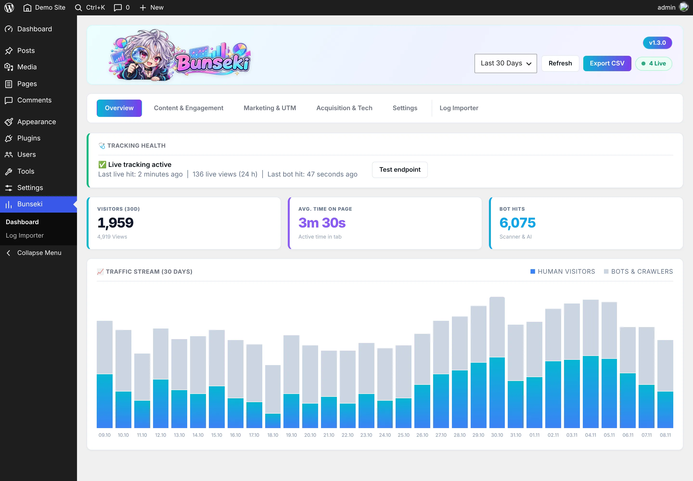
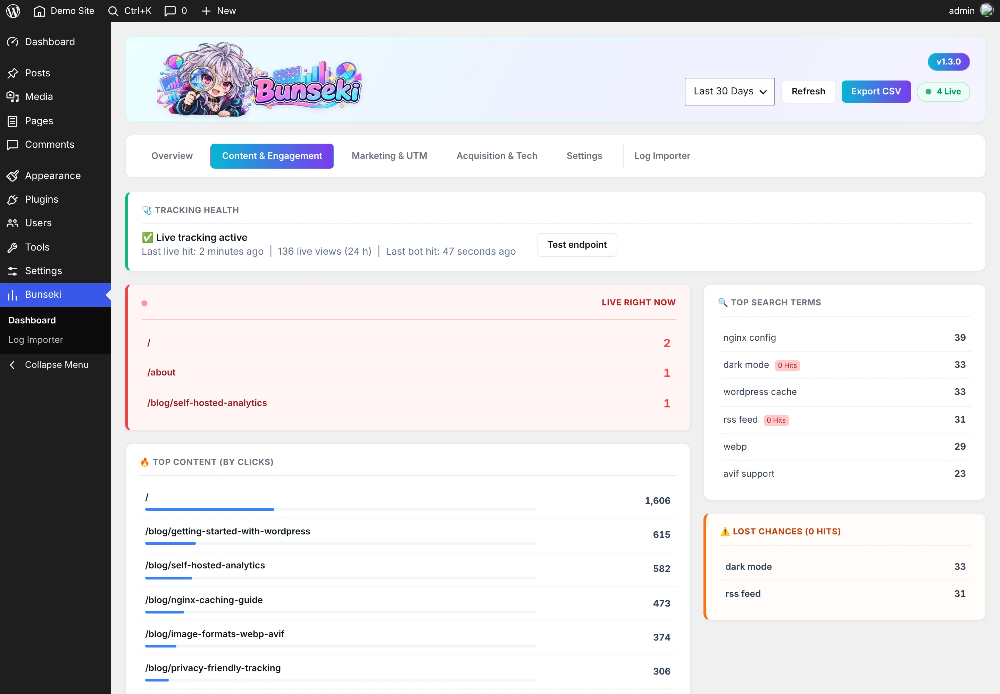
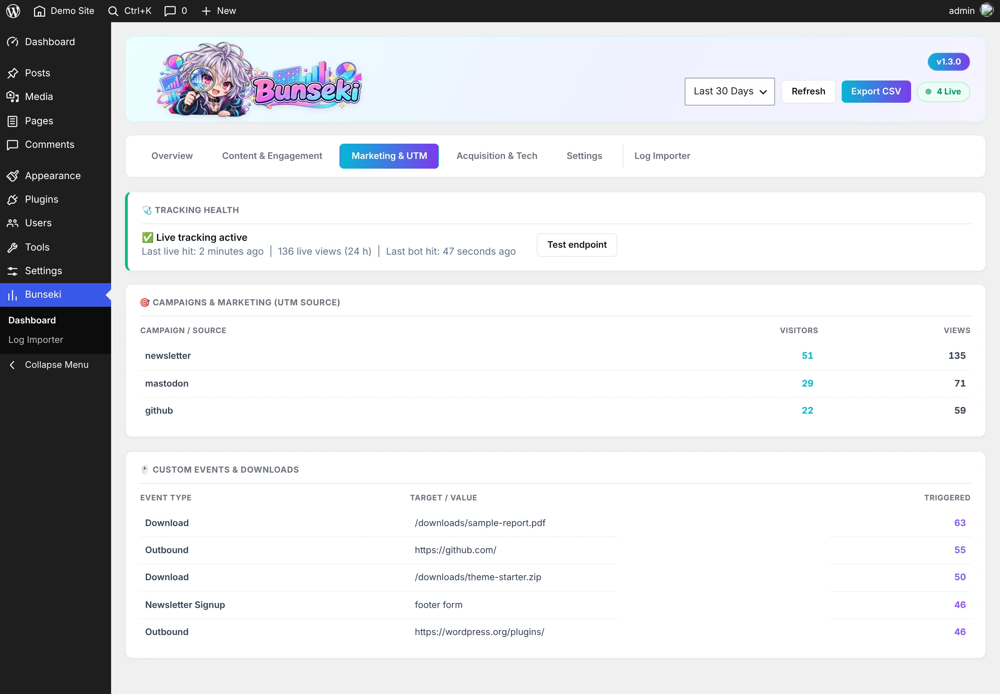
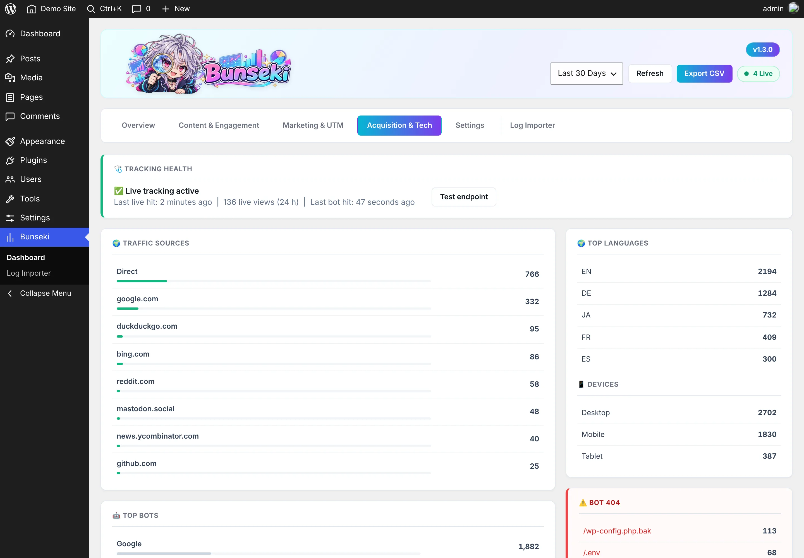
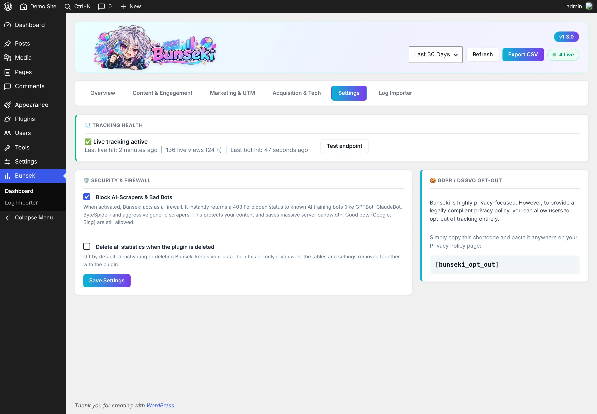
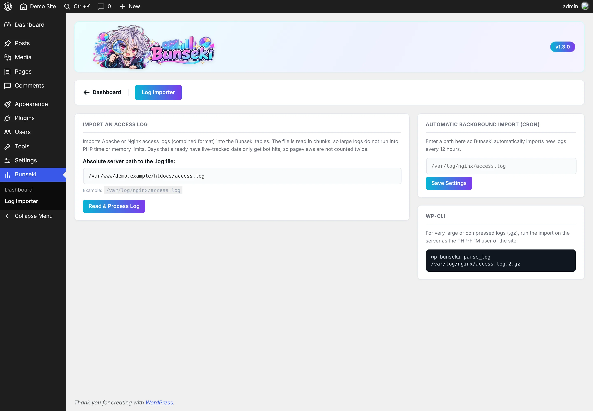
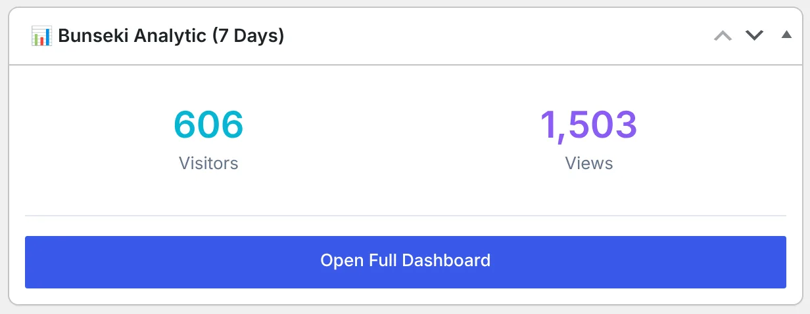

<p align="center"></p>


# Bunseki Analytic

Visitor statistics for WordPress that run entirely on your own server. A small script sends one request per page view to an endpoint of the site; the data is stored in three tables of the WordPress database. No external service is involved.

It also counts bots separately, can block AI scrapers and scripted clients, and can import existing Nginx or Apache access logs.

Current version: `1.3.0` – see the changelog in [readme.txt](readme.txt).

---

## Screenshots

Taken on an empty demo site with sample data.

**Overview** – visitors, time on page, bot hits, daily chart (humans and bots), tracking health



**Content & Engagement** – live pages, top content, time on page, site search terms and searches without results



**Marketing & UTM** – UTM sources, outbound links, downloads and custom events



**Acquisition & Tech** – referrers, bots, languages, devices, 404 requests of bots



**Settings** – bot blocker, data removal on uninstall, opt-out shortcode



**Log Importer** – import of access logs, automatic import, WP-CLI



**Dashboard widget** – last 7 days on the WordPress start page



---

## Requirements

* WordPress 7.1 or newer
* PHP 8.4 or newer
* MySQL or MariaDB

---

## Installation

1. Copy the plugin folder to `wp-content/plugins/bunseki-analytic`.
2. Activate it under **Plugins**.
3. Open **Bunseki** in the admin menu.

Tracking starts right away. Logged-in users are not tracked.

---

## How tracking works

* `js/b-core.js` is loaded on every front-end page for visitors who are not logged in. It sends one `POST` to `/wp-json/bunseki/v1/track` per page view, a heartbeat every 30 seconds while the tab is active, and a last request when the page is closed (for the time on page).
* The endpoint answers with `204` immediately and writes to the database afterwards (`fastcgi_finish_request()` where available).
* Requests are limited to 16 KB, to 120 per minute per IP and user agent, and to the site's own origin. The same page from the same visitor is counted once per 30 seconds.
* Common cache and optimization plugins are told not to delay or combine the script (WP Rocket, LiteSpeed Cache, Perfmatters, Flying Scripts and the `data-cfasync` / `data-noptimize` attributes).
* Visitors that send a bot user agent are counted as bot hits, not as visitors.
* The **Tracking health** card shows when the last live hit arrived and has a button to test the endpoint.

### What is stored

Per page view (`wp_bunseki_log`):

* path of the page (without query string), status code (200 or 404)
* referrer (domain, and the URL without query string for external referrers), `utm_source`
* a daily visitor hash: MD5 of IP address, user agent, local date and `NONCE_SALT`. It changes at midnight of the site's time zone, so visitors cannot be followed over several days.
* device class, operating system, browser, 2-letter browser language, viewport width
* load time, time to first byte, active time on the page
* site search term (`?s=`) and whether the search had results

Per custom event (`wp_bunseki_events`): event name, value (e.g. link target), page and daily hash.

Per bot (`wp_bunseki_bots`): one row per day, bot name, path and status code with a hit counter.

The IP address itself is not stored in the database. For the rate limit and the 30-second duplicate check, short-lived files named after an MD5 of IP and user agent are written to the PHP temp folder and removed regularly.

Rows older than 10 years are deleted by a daily WP-Cron job.

### Opt-out

* Visitors with **Do Not Track** enabled are not tracked.
* The shortcode `[bunseki_opt_out]` shows a button that sets the cookie `bunseki_dnt=1` for one year; from then on that browser is not tracked.

### Behind a proxy

Proxy headers (`CF-Connecting-IP`, `X-Real-IP`, `X-Forwarded-For`) are only used when the request comes from a private or local address (e.g. a local Nginx in front of PHP). To trust them in other setups, add to `wp-config.php`:

```php
define( 'BUNSEKI_TRUST_PROXY_HEADERS', true );
```

---

## Events

Clicks on links to other sites (event `Outbound Link`) and on downloads of `.pdf`, `.zip`, `.rar`, `.doc(x)` and `.xls(x)` files (event `Download`) are recorded automatically. Your own events can be sent from JavaScript:

```js
bunseki.track( 'Newsletter Signup', 'footer form' );
```

Links with `?utm_source=...` are grouped under **Marketing & UTM**.

---

## Bot blocker

**Settings → Block AI-Scrapers & Bad Bots** (off by default). When it is on, these user agents get a `403` before WordPress renders the page:

* AI and data crawlers: GPTBot, ChatGPT-User, ClaudeBot, CCBot, Diffbot, Bytespider, Omgilibot, PerplexityBot
* scripted clients: `curl`, `python`, `wget`, `Go-http-client`

Search engines (Google, Bing, Yandex, Baidu, DuckDuckGo), SEO tools and link preview fetchers (Facebook, X, Discord, Telegram, WhatsApp, Pinterest) are not blocked. Blocked requests still appear in the bot statistics.

Note: monitoring or uptime services that use `curl` or Python as user agent are blocked as well. Requests from the admin area and WP-CLI are never blocked.

---

## Access log import

**Bunseki → Log Importer** imports logs in the Nginx / Apache *combined* format.

* The import runs in chunks in the browser, so large files do not hit PHP time limits.
* Only files in the folder of the automatic import path (or inside the WordPress folder, if none is set) can be read.
* Days that already have live-tracked data only get the bot hits from the log, so visitors are not counted twice.
* Static files, admin, REST, cron, feeds and sitemaps are not counted as page views.
* **Automatic import:** enter a log path; WP-Cron imports it twice a day.

WP-CLI (also for `.gz` files). Run it as the PHP-FPM user of the site:

```bash
wp bunseki parse_log /var/log/nginx/access.log
wp bunseki parse_log /var/log/nginx/access.log.2.gz --force
wp bunseki reset            # deletes all statistics (asks first, --yes skips the question)
```

---

## Other features

* **Time ranges:** 30, 60, 90, 120 days or all data. Dashboard figures are cached for 15 minutes; **Refresh** recalculates them.
* **CSV export** of the selected range (UTF-8 with BOM for Excel; cell content that starts like a formula is neutralized).
* **Dashboard widget** with visitors and views of the last 7 days.
* **Weekly e-mail** with the same figures to the site's admin address (WP-Cron).
* **Dark mode** of the Bunseki pages follows the system setting.
* **Uninstall:** by default the statistics are kept when the plugin is deleted. **Settings → Delete all statistics when the plugin is deleted** removes the tables and options as well.
* Day boundaries follow the time zone set under **Settings → General**.

---

## Updates

Bunseki checks this GitHub repository for new releases (bundled [Plugin Update Checker](https://github.com/YahnisElsts/plugin-update-checker)) and shows them under **Plugins** like any other update. The check uses the public GitHub API; nothing else is sent.

---

## License

GPL v2 or later.
